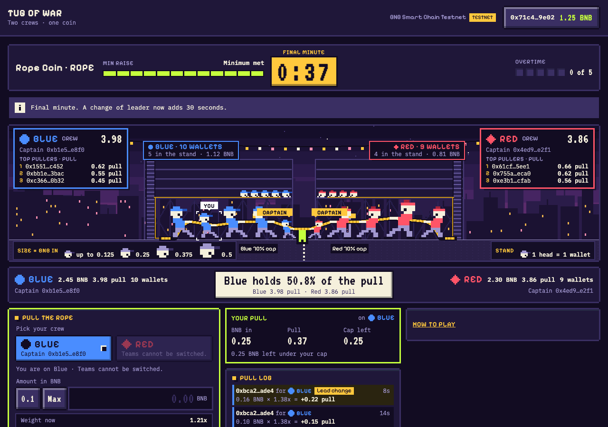

# Tug of War Launch

A token launch played as a game of tug of war on BNB Chain. Two captains open a game, fans put BNB behind Blue or Red during a timed buy-in, and when the clock ends one shared coin launches on Flap. Where the rope ends up decides how the bonus coins and the staking rewards are split between the two crews.

**Live app:** <https://somnus0x.github.io/tug-of-war/> (BSC testnet, chain 97)



## How a game works

1. **Challenge.** A creator opens a game through Flap's Portal and names two captains. One captain deposits to challenge and the other deposits to accept, which starts the clock. If both don't deposit within the accept window, anyone can cancel and the deposits are returned.
2. **Buy-in.** Fans pull for one crew with BNB. Their first pull picks the crew and they can't switch. Early BNB pulls harder: the weight falls from 2.00x at the start to 1.00x at the deadline. A pull in the final minute adds overtime.
3. **Launch.** At the deadline, anyone calls `launch()`. The raise goes to Flap's `launchTaxTokenV2` and one tax token is created with its pool.
4. **Vault.** Players claim their coins and stake them in their crew's vault. Trading tax flows into the vault and is paid out as BNB rewards, split by the final rope position.
5. **Refund.** If the minimum raise isn't reached, everyone takes their BNB back.

## Deployed contracts (BSC testnet, chain 97)

| Contract           | Address                                                                                                                         |
| ------------------ | ------------------------------------------------------------------------------------------------------------------------------- |
| TugLauncherFactory | [`0xbFc1ccCB2D6a611219D387eC9A67a9DCF10C5431`](https://testnet.bscscan.com/address/0xbFc1ccCB2D6a611219D387eC9A67a9DCF10C5431) |
| TugVaultFactory    | [`0xe01A0596892b0b173dc92f3823D48132D1E8B665`](https://testnet.bscscan.com/address/0xe01A0596892b0b173dc92f3823D48132D1E8B665) |

Flap infrastructure the factories use:

| Contract                 | Address                                      |
| ------------------------ | -------------------------------------------- |
| Flap Portal              | `0x000042108465206185A077Edc3F3fd2b49060000` |
| Tax token implementation | `0x7777c57ff7dc441c1715b2e36fa581c48B782222` |
| Flap Trigger Service     | `0x560E9830926C9e0EB98a59c6b9902383Fc0D9Eb2` |
| PancakeSwap V2 router    | `0xc9D63ddCB9549578057EAB6A83a543DdFEE2b8c3` |

## Repo structure

```text
tug-of-war/
├── contracts/                 Foundry project (Solidity 0.8.26)
│   ├── src/
│   │   ├── launcher/          TugLauncher, TugLauncherFactory
│   │   ├── vault/             TugVault, TugVaultFactory
│   │   ├── libraries/         TugMath (pull weight, shares)
│   │   ├── interfaces/        ITug* interfaces and shared types
│   │   └── flap/              Flap base contracts, vendored unchanged
│   ├── script/                Deploy, CreateGame, DemoGame, MineSalt
│   ├── test/                  unit and BSC-testnet fork tests
│   ├── abi/                   exported ABIs used by the web app
│   └── docs/frontend-api.md   calls per screen for the frontend
├── web/                       Vite + React + TanStack Router + wagmi
│   ├── src/
│   └── docs/screenshots/
└── .github/workflows/pages.yml  check, build and deploy web/ to GitHub Pages
```

## Quick start

Contracts (needs [Foundry](https://getfoundry.sh/)):

```sh
cd contracts
forge install
forge build
forge test
```

Web (needs Node 24 and pnpm 12):

```sh
cd web
pnpm install
cp .env.example .env
pnpm dev
```

The app opens at <http://localhost:5173/tug-of-war/> and reads the live testnet contracts by default.

## More detail

- [contracts/README.md](contracts/README.md): BSC testnet runbook (deploy, dry run, live game)
- [contracts/docs/frontend-api.md](contracts/docs/frontend-api.md): contract calls per screen
- [web/README.md](web/README.md): settings, mock mode, screens, code layout

## Built with

Flap · BNB Smart Chain · Foundry · OpenZeppelin · Solady · Vite · React · wagmi/viem
