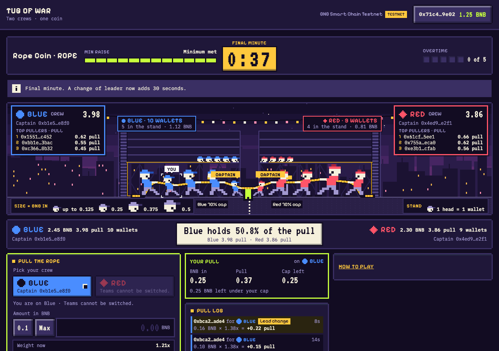
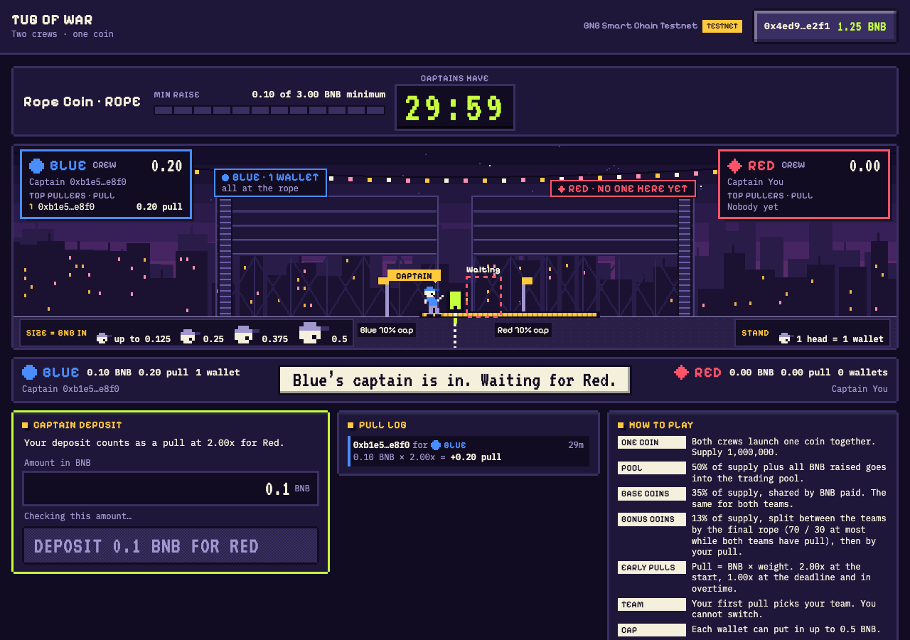
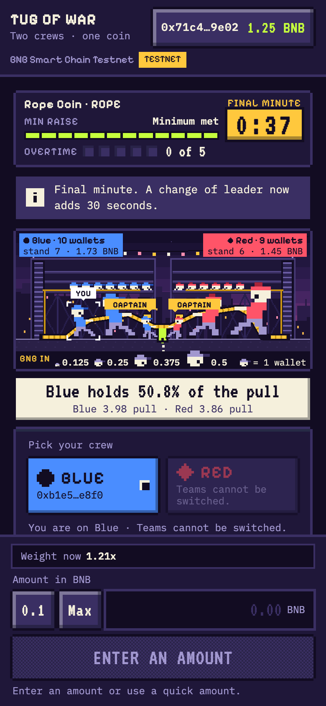
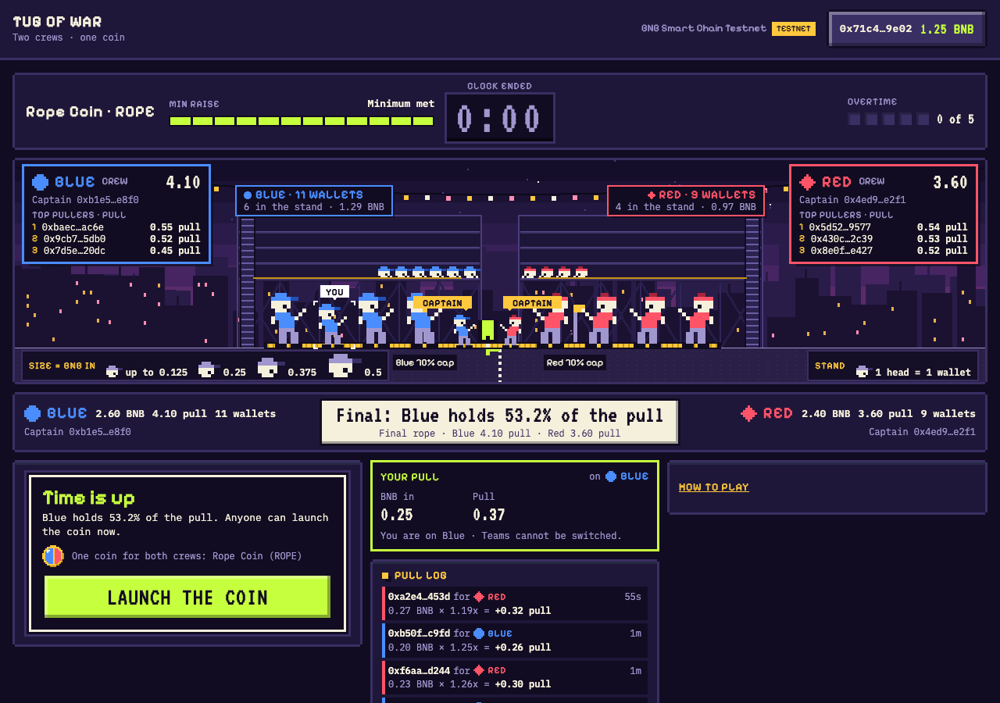
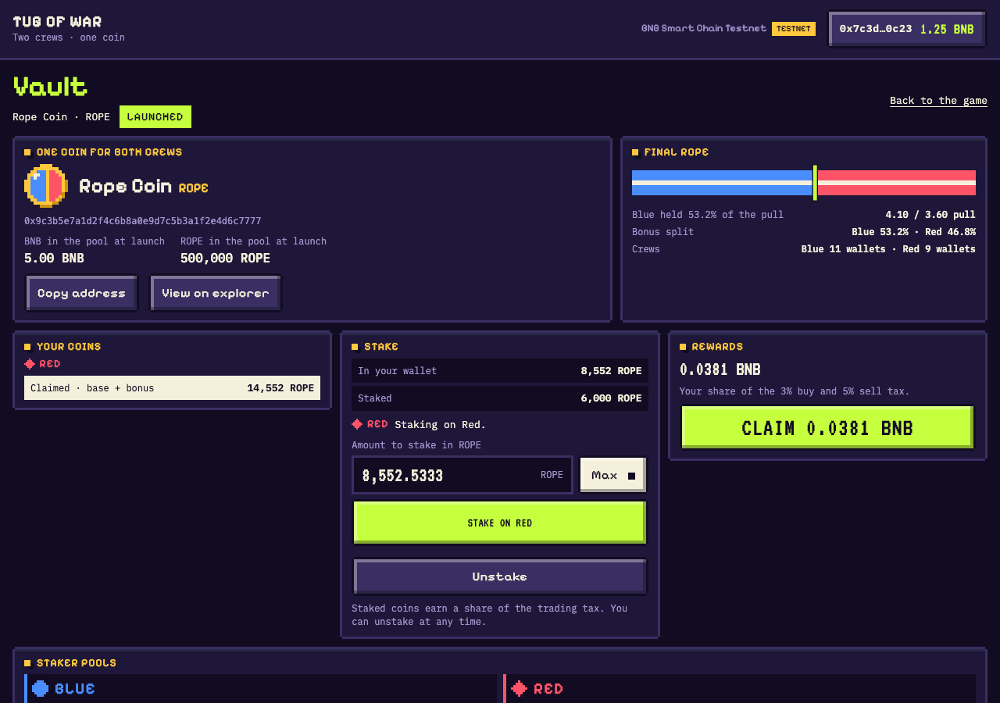
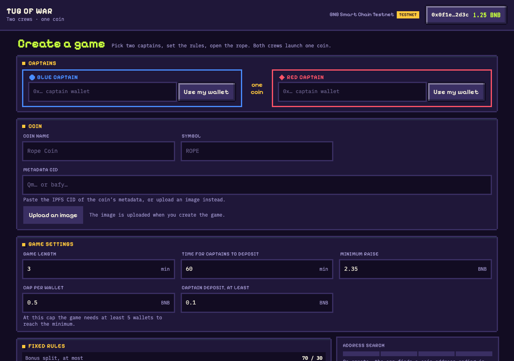
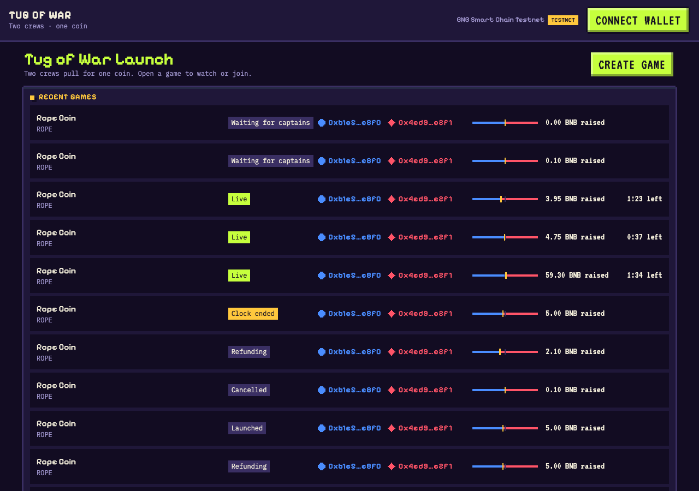

# Tug of War Launch · web

The browser app for Tug of War Launch: two captains open a game, fans pull the rope for a crew, and one shared coin launches on Flap when the clock ends.



Live site: <https://somnus0x.github.io/tug-of-war/>. It runs on mock data for now, because the contracts are not deployed yet.

[What it is](#what-it-is) · [Screens](#screens) · [Quick start](#quick-start) · [Try it without a chain](#try-it-without-a-chain) · [Settings](#settings) · [Going live on testnet](#going-live-on-testnet) · [Scripts](#scripts) · [How the code is organised](#how-the-code-is-organised) · [Deploy](#deploy)

## What it is

- Two captains open a game. Blue stands on the left and Red on the right.
- Fans put BNB in for one crew during a timed round. Your first pull picks your crew and you cannot switch.
- Early BNB pulls harder. The weight falls from 2.00x at the start to 1.00x at the deadline.
- When the clock ends, one shared coin launches on Flap (BNB Chain). The final rope position splits the bonus coins and the staking rewards between the two crews.
- If the minimum raise is not reached, everyone takes their BNB back.

## Screens

|                                                                                                                 |                                                                                       |
| --------------------------------------------------------------------------------------------------------------- | ------------------------------------------------------------------------------------- |
| <br>Waiting for captains to join.                          | <br>A live game on desktop. |
| <br>The same game on a phone. | <br>After the clock: ready to launch.   |
| <br>The vault: stake coins and claim rewards.                               | <br>Create a game.                       |
| <br>Home: the list of games.                                                  |                                                                                       |

## Quick start

You need Node 24 and pnpm 12 (CI uses pnpm 12.15.0). Run everything from the `web/` folder.

```bash
pnpm install
```

```bash
cp .env.example .env
```

```bash
pnpm dev
```

The dev server runs on Vite's default port and serves under the base path from `VITE_BASE`, so the app opens at <http://localhost:5173/tug-of-war/>.

The example settings turn mock mode on (`VITE_FIXTURES=1`), so the app works with no wallet and no chain.

## Try it without a chain

Mock mode serves games, viewers and transactions from local data. Open any game with this link form:

```text
#/g/0x0000000000000000000000000000000000000001?fx=<game>&as=<viewer>&tx=<mode>
```

| Part | Meaning                  | Default                                        |
| ---- | ------------------------ | ---------------------------------------------- |
| `fx` | Which mock game to show. | `live-mid`                                     |
| `as` | Which viewer you are.    | `visitor` without a wallet, `fan-new` with one |
| `tx` | How transactions behave. | `normal`                                       |

### Mock games

Waiting for captains:

| Game              | What it shows                                   |
| ----------------- | ----------------------------------------------- |
| `waiting-none`    | No captain has joined yet.                      |
| `waiting-blue-in` | Blue captain is in, Red is not.                 |
| `waiting-expired` | The join time ran out with one captain missing. |
| `cancelled`       | A game cancelled before it started.             |

Live:

| Game                 | What it shows                                      |
| -------------------- | -------------------------------------------------- |
| `live-mid`           | A mid-game rope, 84 seconds left. The default.     |
| `live-first-pulls`   | The first few pulls, 168 seconds left.             |
| `live-min-not-met`   | Live, with the minimum raise not yet met.          |
| `live-one-sided`     | Blue far ahead of Red.                             |
| `live-tie`           | Both crews level on pull.                          |
| `live-final-minute`  | Under a minute left.                               |
| `live-overtime-1`    | The first overtime extension.                      |
| `live-overtime-last` | The last overtime extension.                       |
| `live-big-crowd`     | Many fans on each crew.                            |
| `live-auto-launch`   | Live, with auto-launch scheduled.                  |
| `live-auto-stopped`  | Live, with auto-launch scheduled and then stopped. |

After the clock:

| Game                      | What it shows                                                                             |
| ------------------------- | ----------------------------------------------------------------------------------------- |
| `ended-can-launch`        | The clock ended and anyone can launch.                                                    |
| `ended-auto-launch`       | The clock ended with auto-launch scheduled. Anyone can still launch.                      |
| `ended-floor-blocked`     | The clock ended, but the raise is below Flap's liquidity floor, so the launch is on hold. |
| `refunding-min-missed`    | The minimum raise was missed, so BNB can be taken back.                                   |
| `refunding-grace-expired` | The launch grace time ran out, so BNB can be taken back.                                  |
| `refunding-auto-launch`   | Refunding, with unused auto-launch fee for the funder to withdraw.                        |

Launched:

| Game                   | What it shows                                                     |
| ---------------------- | ----------------------------------------------------------------- |
| `launched`             | The coin is out. Claims and the vault are open.                   |
| `launched-quiet`       | Launched, with one staker pool still empty.                       |
| `launched-auto-launch` | Launched, with unused auto-launch fee for the funder to withdraw. |

### Mock viewers

| Viewer             | Who you are                                                          |
| ------------------ | -------------------------------------------------------------------- |
| `visitor`          | No wallet connected.                                                 |
| `fan-new`          | A connected fan with no pull yet.                                    |
| `fan-blue`         | Fan on Blue, 0.25 BNB in.                                            |
| `fan-red`          | Fan on Red, 0.20 BNB in.                                             |
| `fan-capped`       | Fan on Blue, 0.50 BNB in, 0.40 BNB balance.                          |
| `captain-blue`     | The Blue captain.                                                    |
| `captain-red`      | The Red captain.                                                     |
| `captain-blue-new` | The Blue captain just after launch: no captain coins vested yet.     |
| `funder`           | The wallet that paid for auto-launch.                                |
| `holder-blue`      | Blue fan with claimed coins in the wallet, nothing staked.           |
| `holder-free`      | Holds coins but never pulled, so it picks a side on its first stake. |
| `staker-rewards`   | Red fan with coins staked and BNB rewards to claim.                  |
| `staker-quiet`     | Blue fan with coins staked and no rewards yet.                       |
| `fan-refunded`     | Blue fan who has already taken a refund.                             |

### Transaction modes

| `tx`     | Effect                                                |
| -------- | ----------------------------------------------------- |
| `normal` | The transaction goes through.                         |
| `reject` | The wallet request is rejected.                       |
| `revert` | The contract call reverts.                            |
| `slow`   | Mining takes 8 seconds instead of 1.5.                |
| `raced`  | Another wallet launches the coin first (launch only). |

### Ready-made links

- [Live game as a new fan](https://somnus0x.github.io/tug-of-war/#/g/0x0000000000000000000000000000000000000001?fx=live-mid&as=fan-new)
- [Waiting for captains, as the Red captain](https://somnus0x.github.io/tug-of-war/#/g/0x0000000000000000000000000000000000000001?fx=waiting-blue-in&as=captain-red)
- [Clock ended, ready to launch](https://somnus0x.github.io/tug-of-war/#/g/0x0000000000000000000000000000000000000001?fx=ended-can-launch&as=fan-blue)
- [Vault as a staker with rewards](https://somnus0x.github.io/tug-of-war/#/g/0x0000000000000000000000000000000000000001/vault?fx=launched&as=staker-rewards)

### Other pages

| Address                | Page                               |
| ---------------------- | ---------------------------------- |
| `#/`                   | Home                               |
| `#/create`             | Create a game                      |
| `#/g/{launcher}`       | A game                             |
| `#/g/{launcher}/vault` | The vault for a game               |
| `#/gallery`            | Component gallery, dev server only |

The router uses hash history, so these work on static hosting.

The other pages have mock switches too: `#/?fx=empty` (no games), `#/?fx=unreadable` (the list cannot be read), `#/create?as=fan-new` (a connected creator), `#/create?fx=floor-unavailable` (creation closed). Add `&auto=1` to a live game link to see the auto-launch card, which is off unless `VITE_AUTO_LAUNCH=1`.

## Settings

Settings are read from `web/.env` (see [`.env.example`](.env.example)) and validated by [`src/lib/env-schema.ts`](src/lib/env-schema.ts).

| Name                 | What it does                                                                                                                          | Example                                                                                           | Needed                               |
| -------------------- | ------------------------------------------------------------------------------------------------------------------------------------- | ------------------------------------------------------------------------------------------------- | ------------------------------------ |
| `VITE_CHAIN_ID`      | Chain the app talks to. A positive integer.                                                                                           | `97`                                                                                              | Required                             |
| `VITE_RPC_URLS`      | Comma-separated RPC addresses, at least one, `http` or `https`.                                                                       | `https://data-seed-prebsc-1-s1.bnbchain.org:8545,https://data-seed-prebsc-2-s1.bnbchain.org:8545` | Required                             |
| `VITE_TUG_FACTORY`   | Address of the game factory, `0x` and 40 hex digits.                                                                                  | `0x0000000000000000000000000000000000000000`                                                      | Required                             |
| `VITE_WC_PROJECT_ID` | WalletConnect (Reown) project id. Must not be empty.                                                                                  | `replace-with-reown-project-id`                                                                   | Required                             |
| `VITE_FIXTURES`      | `1` for mock data, `0` for the chain.                                                                                                 | `1`                                                                                               | Required                             |
| `VITE_BASE`          | Base path. Starts and ends with `/`.                                                                                                  | `/tug-of-war/`                                                                                    | Optional, defaults to `/tug-of-war/` |
| `VITE_TRADE_URL`     | Trade link for the launched coin. Must contain `{token}`.                                                                             | `https://example.com/trade/{token}`                                                               | Optional, empty means none           |
| `VITE_AUTO_LAUNCH`   | Set to `1` to show the option to schedule auto-launch. Leave it off on testnet, where the trigger cannot launch within its gas limit. | `1`                                                                                               | Optional, off unless `1`             |

If a required setting is missing or invalid, the dev server shows a settings screen that names each problem. The build fails with the same list.

## Going live on testnet

Do this once the contracts are deployed.

1. Set `VITE_TUG_FACTORY` to the deployed factory address.
2. Set `VITE_FIXTURES=0`.
3. Set `VITE_WC_PROJECT_ID` to a real project id from Reown.
4. Set `VITE_RPC_URLS` to your RPC addresses, and keep `VITE_CHAIN_ID=97` for BSC testnet.
5. For the GitHub Pages build, add repository variables with the same names (Settings, Secrets and variables, Actions, Variables). The workflow reads `VITE_BASE`, `VITE_CHAIN_ID`, `VITE_RPC_URLS`, `VITE_TUG_FACTORY`, `VITE_WC_PROJECT_ID` and `VITE_FIXTURES` from `vars` and falls back to the example values when a variable is not set.

If the contract interface changes, copy the new ABIs and regenerate the typed bindings:

```bash
pnpm run abi
```

What the contracts expose is described in [`../contracts/docs/frontend-api.md`](../contracts/docs/frontend-api.md).

### Not yet verified

- Nothing has been run against deployed contracts.
- No real wallet or phone has been tested.
- The WalletConnect id in the example is a placeholder.

## Scripts

| Script              | What it does                                                     |
| ------------------- | ---------------------------------------------------------------- |
| `pnpm dev`          | Start the Vite dev server.                                       |
| `pnpm build`        | Type-check, then build to `dist/`.                               |
| `pnpm preview`      | Serve the built `dist/` locally.                                 |
| `pnpm format`       | Format with Oxfmt.                                               |
| `pnpm format:check` | Check formatting without writing.                                |
| `pnpm lint`         | Run Oxlint with type-aware rules.                                |
| `pnpm comments`     | Fail if any source file has a comment.                           |
| `pnpm tokens`       | Fail if colours are used outside tokens.                         |
| `pnpm doctor`       | Run React Doctor, failing on errors.                             |
| `pnpm test`         | Run the Vitest suite once.                                       |
| `pnpm check`        | Run all the checks below.                                        |
| `pnpm abi`          | Copy the ABIs from `../contracts/abi/` and run `wagmi generate`. |

`pnpm run check` runs, in order:

1. `pnpm run format:check`
2. `pnpm run lint`
3. `pnpm run comments`
4. `pnpm run tokens`
5. `tsc --noEmit`
6. `pnpm run doctor`
7. `pnpm run test`

## How the code is organised

Built with Vite, React 19, TypeScript, TanStack Router (hash history) and Query, wagmi and viem, RainbowKit, Zod, Oxlint, Oxfmt, React Doctor and Vitest.

```text
src/
  app/        wiring: env, router, query client, wagmi, wallet theme
  routes/     one file per page; compose features only
  features/   game, vault, create, home, tx, wallet
  contracts/  the source interface, chain reads and writes, mock data, ABIs
  scene/      the drawn rope, crews and stand, from plain values
  ui/         shared pieces: modal, toast, banner, buttons, pixel shapes
  copy/       every user-facing string
  lib/        pure helpers: format, units, clock, phase, links
  styles/     tokens, base, fonts, shell
```

Import layers, from top to bottom:

```text
routes → features → contracts · scene · ui · copy → lib
```

The linter ([`.oxlintrc.json`](.oxlintrc.json)) and two scripts in [`tools/`](tools/) enforce these rules:

- Named exports only, no default exports.
- No comments in source files.
- Strings the user sees live only in [`src/copy/`](src/copy/).
- Amounts are formatted only in [`src/lib/format.ts`](src/lib/format.ts). `toFixed`, `toLocaleString`, `formatEther` and `formatUnits` are blocked elsewhere.
- Chain access (wagmi, viem actions) is allowed only in `src/contracts/`, `src/app/` and `src/features/wallet/`.
- Files are at most 300 lines.
- Colours appear only as tokens, from [`src/styles/tokens.css`](src/styles/tokens.css).
- Features do not import each other. Only `features/wallet` is shared.
- `scene/` and `ui/` take plain values and import no wallet or chain code.

Every page reads through a source interface: one each for the game ([`src/contracts/source.ts`](src/contracts/source.ts)), the vault, the create form and the home list. Each is either its chain source or its mock source, chosen once by `VITE_FIXTURES`. Pages never know which one they have.

Every transaction goes through one lifecycle in [`src/contracts/tx/lifecycle.ts`](src/contracts/tx/lifecycle.ts): check, simulate, wallet, pending, mined. Failures pass through one error map in [`src/copy/errors.ts`](src/copy/errors.ts), so a rejection, a revert or a missing fee reads the same on every screen.

## Share links and wallets

Share links use the query form, with the address in a query string and no hash:

```text
https://somnus0x.github.io/tug-of-war/?g={launcher}&team=blue|red&b={block}
```

`team` and `b` (a block number) are optional, and `v=vault` points to the vault. On load the app turns the link into the matching hash route. This form exists because it works inside wallet browsers and on static hosting, where a path or a hash can be dropped.

On phones with no wallet in the browser, the app shows "Open in a wallet" links for MetaMask, Trust Wallet and OKX Wallet. For Binance Wallet it tells the user to paste the link into the wallet's own browser.

Nothing in the app opens a new tab.

## Deploy

The workflow [`.github/workflows/pages.yml`](../.github/workflows/pages.yml) deploys to GitHub Pages on pushes to `main` that touch `web/`. Pull requests run the same install, `pnpm run check` and `pnpm run build`, but do not deploy.

## Accessibility and phones

- Teams use shapes as well as colours: a circle for Blue and a diamond for Red.
- Touch targets are 44px (`--touch-target`).
- Motion stops when the system asks for reduced motion.
- Clock changes, game events and transaction results are announced to screen readers through polite live regions.
- Every page is laid out for a 390px phone as well as a desktop, with the main action in a bar at the bottom of the game page.
- On a phone browser with no wallet, the header offers links that open the page inside a wallet app.
